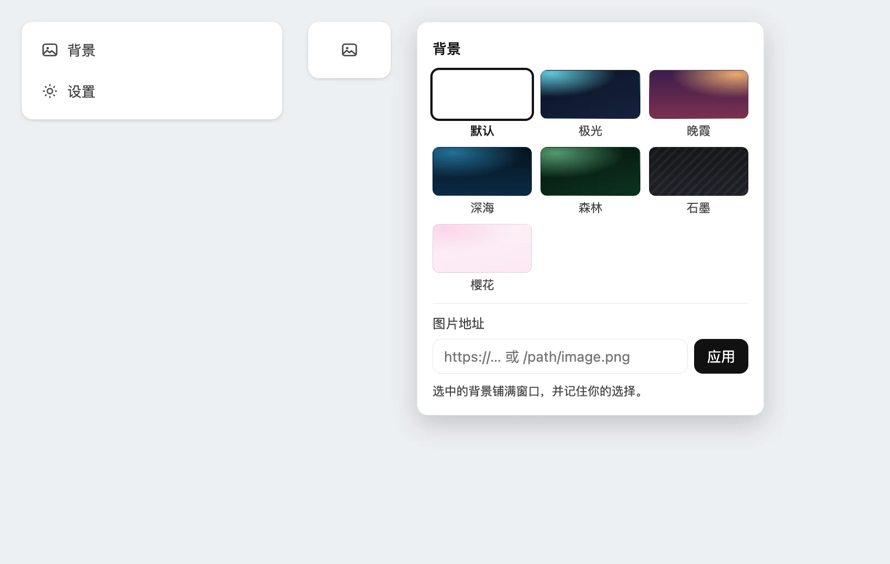

# dsh-bg-switcher

[English](README.en.md) | 中文

[](https://github.com/deepseek-ai/deepseek-harness)
[](https://github.com/topics/dsh-plugin)
[](LICENSE)

DeepSeek Harness 插件：在 **设置 → 通用**、「外观」下方加一行「背景」，可选 7 个预设色卡或自定义图片地址，
铺满窗口并记住选择。



## 安装

### 交给 agent

把下面这段贴进 Harness 对话：

```text
安装 DSH 插件 https://github.com/Bainianzzz/dsh-bg-switcher：
1. 克隆仓库到 ~/dsh-plugins/dsh-bg-switcher；
2. plugin_manager 工具，action=install_bundle，target 填该目录绝对路径；
3. 确认 application 为 applied，否则把 warnings 与 error 报给我；
4. cordis_inspect_query 查客户端 settings.general.item 插槽，确认出现 id 为 bg-switcher 的条目。
```

### 手动安装

1. 侧边栏选中 **插件 / Plugins**
2. 右上角点 **添加插件 / Add plugin**
3. 地址栏填入 `https://github.com/Bainianzzz/dsh-bg-switcher`，点 **安装 / Install**
4. 完成后点 **立即启用 / Enable now**

> **注意**
>
> - 「设置 → 内置插件」是只读清单，安装入口只在侧边栏的「插件」页。
> - 升级目前需先卸载再安装。

命令行等价做法（`web` 换成你的 profile 名）：

```bash
git clone https://github.com/Bainianzzz/dsh-bg-switcher ~/dsh-plugins/dsh-bg-switcher
dsh plugin --profile web add ~/dsh-plugins/dsh-bg-switcher
```

装完把组合包名 `@local/dsh-bg-switcher` 加进 profile 的 `dsh.profile.bundles`。

## 实现

- 背景画在 `html` 上；`--dsw-alias-bg-base` 经 `ctx.theme.overrideTokens` 置为 `transparent`，抬升表面保持不透明
- 亮暗色各配一层遮罩，暗色由 `html:has(body[data-ds-dark-theme])` 跟随
- 样式标签与 token 层在 `ctx.effect` 里创建并返回清理函数，停用即回到主题默认

## 许可

[MIT](LICENSE)
